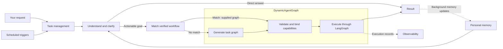

# Karen

English | [简体中文](README_cn.md)

A personal agent that remembers useful context and turns your requests into results.

Tell Karen what you need. It retrieves relevant memories, asks for missing information when necessary, and uses tools to research, organize, and deliver the work. Use it from your terminal.

## Why build Karen?

Working with an agent often means repeating your background, turning a rough idea into a precise prompt, and connecting the steps yourself. Karen aims to reduce that effort over repeated use.

Its focus is continuity between **your context, your intent, and the work delivered**:

- **Personal context across tasks.** Retrieve relevant preferences and past events while keeping unrelated task conversations separate.
- **Clarification before execution.** Preserve the original request and your answers, asking for information needed to make the goal actionable.
- **Execution shaped by the goal.** DynamicAgentGraph generates a task graph for each confirmed goal, organizing model and tool calls with explicit data dependencies. New goals can use the available capabilities without a handwritten workflow for each request.
- **Experience that can be reused.** Turn completed work into verified workflows that compatible requests can reuse with current parameters and permissions.

These choices shape Karen as a personal agent for an ongoing relationship with its user. Proactively discovering and advancing work remains the longer-term direction.

## What you can do

- **Keep context:** remember your preferences and recall past conversations.
- **Get work done:** research topics and save findings as text or HTML.
- **Manage tasks:** run independent tasks concurrently and schedule recurring requests.
- **Reuse successful work:** compatible requests can use verified workflows.
- **See what happened:** inspect decisions, tool calls, and results in a local dashboard.

```text
I like history, archaeology, and cycling.
What are my hobbies?
Research today's GitHub Trending projects and save a summary to /tmp/trending.html.
/schedule Every day at noon, summarize the latest technology news.
```

Karen is under active development. Task results depend on available tools and model decisions; proactive task discovery is not yet supported.

## Architecture

Karen manages context, clarification, and tasks. **[DynamicAgentGraph](https://github.com/DavidLiuXh/DynamicAgentGraph) is the execution foundation that turns those decisions into work.** Its central design connects goal-driven graph generation with programmatic validation and execution:

- **Generate the structure for the goal.** The planner selects registered capabilities and defines steps, dependencies, and state in a structured graph, including parallel work where appropriate.
- **Validate before acting.** Code checks tool versions, input/output contracts, dependencies, permissions, and resource limits before compiling an accepted graph into LangGraph. Invalid candidates receive bounded repair feedback.
- **Give experience an executable form.** Recorded graphs provide the structure Karen uses to discover reusable workflows. Reused graphs pass through the same authorization and validation boundary.

Karen relies on this layer to move from understanding a request to coordinated execution, and from one completed task to a reusable process.



## Quick start

You need Python 3.11 or 3.12, [uv](https://docs.astral.sh/uv/getting-started/installation/), [Ollama](https://ollama.com/download), and a DeepSeek API key.

**1. Install from source.** Keep the two repositories beside each other:

```bash
git clone https://github.com/DavidLiuXh/DynamicAgentGraph.git
git clone https://github.com/DavidLiuXh/Karen.git
cd Karen
uv sync --python 3.12
```

**2. Prepare memory embeddings.** With Ollama running, download the model:

```bash
ollama pull bge-m3:latest
```

**3. Configure API keys.** Create `.env` in the Karen directory:

```dotenv
DEEPSEEK_API_KEY=your_deepseek_api_key
TAVILY_API_KEY=your_tavily_api_key
```

Tavily is optional and enables web search. `.env` is ignored by Git.

**4. Start Karen:**

```bash
uv run --env-file .env karen --observe
```

Open the printed dashboard address, usually `http://127.0.0.1:8765/`. Omit `--observe` if you only want the terminal. Use `--timezone Asia/Shanghai` to set your timezone explicitly.

## Everyday use

| Command | Purpose |
| --- | --- |
| `/new request` | Start an independent task |
| `/tasks` | List tasks and their IDs |
| `/reply ID answer` | Answer a task's clarification question |
| `/cancel ID` | Cancel a task |
| `/schedule request` | Create or change a schedule in natural language |
| `/schedule list` | List schedules |
| `/exit` | Exit Karen |

Schedules persist across restarts, but **trigger only while Karen is running**. Missed occurrences are not replayed.

Gmail read-only access is available with [separate OAuth configuration](docs/GMAIL.md); continuous new-mail monitoring is not implemented yet.

## See the work


Memory and runtime records are stored under `~/.Karne/`. Required inputs are sent to the configured model and search services, which may incur API charges.

## Learn more

- [Detailed guide](docs/GUIDE.md): architecture, configuration, workflows, memory, and development.
- [Task management](docs/TASK_MANAGER.md) · [Observability](docs/OBSERVABILITY.md)
- [Evaluation reports](docs/GUIDE.md#evaluation-results): historical results, scope, and known limitations.

Task planning and execution are powered by [DynamicAgentGraph](https://github.com/DavidLiuXh/DynamicAgentGraph).
