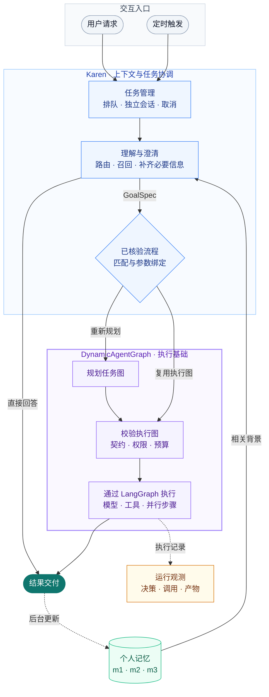

# Karen

[English](README.md) | 简体中文

一个记得你的背景、帮你把想法变成结果的个人 Agent。

告诉 Karen 你想做什么。它会查找相关记忆，必要时追问缺失信息，再使用工具完成研究、整理和交付。你可以在终端中与它交流。

## 为什么构建 Karen？

使用 Agent 时，用户常常需要反复交代背景，把模糊想法整理成精确提示词，还要亲自衔接工作的各个步骤。Karen 希望在持续使用中减少这些负担。

它的设计重点，是让**个人背景、真实意图与任务交付**衔接起来：

- **跨任务的个人记忆。** 按需找回相关偏好与历史事件，同时保持无关任务的对话隔离。
- **执行前的必要澄清。** 保留原始请求和你的回答，围绕目标能否执行来补充必要信息。
- **随目标组织的执行。** DynamicAgentGraph 为已确认的目标动态生成任务图，用明确的数据依赖组织模型与工具调用，让新目标可以组合已有能力，无需逐个手写工作流。
- **能够复用的工作经验。** 将已完成的工作提炼为经核验的流程，让适用的新请求使用本轮参数与权限复用。

这些选择让 Karen 围绕与用户的长期协作来组织能力。主动发现问题并推进工作，是后续的发展方向。

## 你可以用它做什么

- **记住背景：** 保存个人偏好，回顾过去的交流。
- **完成工作：** 研究主题，将结果整理为文字或 HTML 文件。
- **管理任务：** 同时推进独立任务，安排周期性请求。
- **复用流程：** 适用的请求可以复用已核验的工作流程。
- **查看过程：** 在本地页面检查决策、工具调用和执行结果。

```text
我喜欢历史、考古和骑行。
我有哪些爱好？
整理今天的 GitHub Trending 项目，保存到 /tmp/trending.html。
/schedule 每天中午12点整理最新科技新闻。
```

Karen 仍在持续开发中。任务效果取决于可用工具和模型判断，目前尚不支持主动发现任务。

## 架构

Karen 负责上下文、澄清与任务管理。**[DynamicAgentGraph](https://github.com/DavidLiuXh/DynamicAgentGraph) 是将这些判断转化为实际工作的执行基础。** 它的核心设计，是把目标驱动的图生成与程序化校验、执行连接起来：

- **根据目标生成结构。** 规划器选择已注册能力，以结构化任务图定义步骤、依赖和状态，在适用时安排并行工作。
- **行动前校验。** 代码检查工具版本、输入输出契约、依赖、权限与资源限制，通过后编译为 LangGraph 执行；无效候选图会收到有次数限制的修复反馈。
- **让经验具有可执行的形式。** 已记录的任务图为 Karen 提炼可复用流程提供结构基础；复用图仍经过相同的授权与校验边界。

Karen 依靠这一层完成从理解请求到协同执行、从单次任务到流程复用的衔接。



实线表示请求与执行流程，虚线表示后台更新与诊断记录。复用执行图与新规划的图经过相同的校验和执行边界。

## 快速开始

需要 Python 3.11 或 3.12、[uv](https://docs.astral.sh/uv/getting-started/installation/)、[Ollama](https://ollama.com/download) 和 DeepSeek API 密钥。

**1. 从源码安装。** 两个仓库需放在相邻目录：

```bash
git clone https://github.com/DavidLiuXh/DynamicAgentGraph.git
git clone https://github.com/DavidLiuXh/Karen.git
cd Karen
uv sync --python 3.12
```

**2. 准备记忆向量模型。** 启动 Ollama 后下载模型：

```bash
ollama pull bge-m3:latest
```

**3. 配置密钥。** 在 Karen 目录创建 `.env`：

```dotenv
DEEPSEEK_API_KEY=your_deepseek_api_key
TAVILY_API_KEY=your_tavily_api_key
```

Tavily 为可选配置，用于网络搜索。`.env` 已被 Git 忽略。

**4. 启动 Karen：**

```bash
uv run --env-file .env karen --observe
```

打开终端打印的观测地址，通常为 `http://127.0.0.1:8765/`。只使用终端时可省略 `--observe`；使用 `--timezone Asia/Shanghai` 可显式指定时区。

## 日常使用

| 命令 | 用途 |
| --- | --- |
| `/new 内容` | 发起独立任务 |
| `/tasks` | 查看任务及编号 |
| `/reply ID 回答` | 回答指定任务的澄清问题 |
| `/cancel ID` | 取消任务 |
| `/schedule 内容` | 用自然语言创建或修改定时规则 |
| `/schedule list` | 查看定时规则 |
| `/exit` | 退出 Karen |

定时规则会跨重启保存，但**仅在 Karen 运行期间触发**，错过的周期不会补跑。

可[单独配置 OAuth](docs/GMAIL.md) 启用 Gmail 只读访问；持续新邮件监测尚未实现。

## 看见执行过程


记忆与运行记录保存在 `~/.Karne/`。所需输入会发送到配置的模型和搜索服务，可能产生 API 费用。

## 进一步了解

- [详细指南](docs/GUIDE_cn.md)：架构、配置、可复用流程、记忆与开发说明。
- [任务管理](docs/TASK_MANAGER.md) · [运行观测](docs/OBSERVABILITY.md)
- [评测报告](docs/GUIDE_cn.md#评测表现)：历史结果、适用范围与已知局限。

任务规划与执行由 [DynamicAgentGraph](https://github.com/DavidLiuXh/DynamicAgentGraph) 提供。
