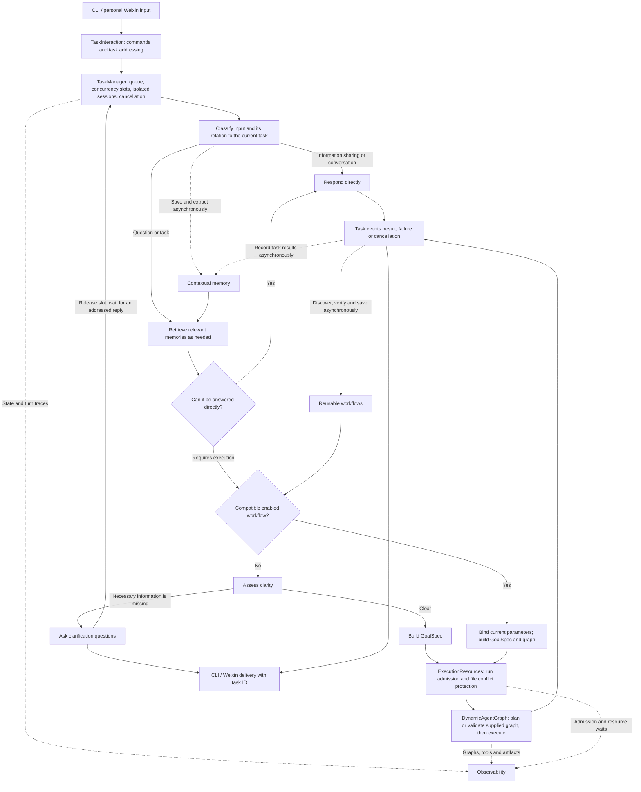
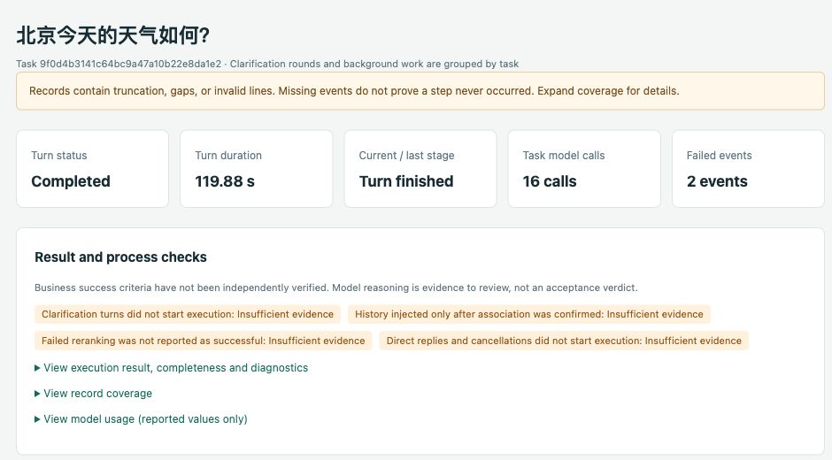
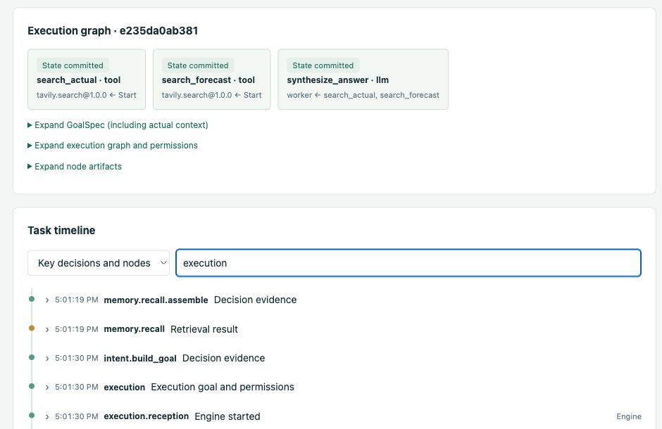

# Karen detailed guide

English | [简体中文](GUIDE_cn.md)

Karen is a personal agent that understands what you want to do, retrieves relevant memories, turns requests into goals with success criteria, and uses tools to carry them out.

Our aim is to build a Personal Agent that understands its user, proactively identifies problems, and moves work forward. **The current version supports user-initiated conversations, contextual memory, task execution, scheduled tasks, reusable workflows, and observability. Proactive task discovery and pausing execution for user confirmation are not yet implemented.**

## Why build Karen?

Using an agent often leaves users responsible for connecting the steps: repeating background information, filling in missing requirements, keeping unrelated tasks separate, and figuring out where a failed request got stuck.

Karen aims to reduce that work and make the path from a request to a result more continuous:

- **Clarify what matters.** Natural language is often incomplete, but not every unspecified preference needs a question. Karen distinguishes necessary information from details that can use reasonable defaults, preserves the original request and clarification answers, and works toward an executable goal.
- **Keep useful context available.** Users should not have to repeat their preferences and experiences in every interaction. Each new request retrieves relevant background; unrelated questions do not automatically inherit the entire recent conversation.
- **Connect goals to execution.** Requests that require research, actions, or files enter a task engine through a shared goal contract, with records of execution, outputs, and failures.
- **Make behavior inspectable and improvable.** Runtime traces help locate problems in routing, clarification, memory, planning, and tool calls. Fixed evaluations check whether general fixes work.

## What can Karen do today?

| Capability | What it supports |
| --- | --- |
| Multi-turn conversation and input routing | Distinguishes information sharing, casual conversation, questions, task requests, and updates or cancellation of a task awaiting clarification |
| Concurrent task management | Shared CLI and Weixin scheduling, isolated sessions, addressed multi-turn replies, queueing and cancellation; two concurrent advances by default |
| Scheduled tasks | Create, update, delete, list, or manually trigger schedules through `/schedule` and natural language in CLI or Weixin; rules survive restarts |
| Necessary clarification | Asks specific questions when required information is missing, merges the answers, and reassesses until the goal is clear |
| Personal contextual memory | Automatically extracts and verifies long-term facts, preferences, and event summaries; supports retrieval across restarts and changes to facts |
| Research and deliverables | Searches public sources, reads web pages, organizes text, writes text or HTML files under `/tmp`, and requests that the local browser open HTML files |
| Reusable workflows | Discovers parameterized workflows from newly completed tasks in the background; compatible requests reuse a validated graph without full intent extraction or planning |
| Observability | Shows decisions, retrieval candidates, model calls, execution graphs, artifacts, and the causes of failures or degraded operation |

For example, you can tell Karen “I like history and archaeology” and “I enjoy sports, such as cycling,” then later ask “What are my hobbies?” You can also ask it to research a topic, organize the findings, and save them as HTML. Memory writes run in the background, so new information may take time to become retrievable.

The current interaction interfaces are the CLI and personal Weixin. Task completion depends on registered tools, available data, and model decisions. Known semantic and execution issues are described in the evaluation section below.

## How Karen works

Karen uses modules with high cohesion and low coupling. Input understanding, contextual memory, task management, reusable workflows, and observability are separate modules within Karen; [DynamicAgentGraph](https://github.com/DavidLiuXh/DynamicAgentGraph) handles task planning and execution.



Task management sits between the channels and input understanding: `TaskInteraction` assigns messages explicitly, while `TaskManager` maintains isolated sessions, controls concurrency and delivers events. Waiting for clarification releases a slot; an addressed reply resumes the same session. Execution resources control run admission and file access, acquiring path leases at actual tool calls and retaining them until the graph ends. Independent graphs can overlap; reused and newly planned graphs follow the same protection rules. Background memory writes and workflow discovery do not occupy foreground task-advancement slots.

### From input to an executable goal

The input module uses LangGraph to express response, clarification, and goal-building flows. Sharing personal information does not require task planning. Questions answerable from the current input or relevant memories receive a direct response; requests requiring external information, actions, or deliverables enter the execution path.

Clarification preserves the original request, pending questions, and their associated answers. A partial answer does not discard other pending questions. Each turn reassesses clarity and asks only for information necessary to determine the goal, scope, deliverable, or acceptance criteria. The user's timezone and the initial input time provide the reference for relative dates such as “today” and “tomorrow.”

Once the goal is clear, Karen creates a DynamicAgentGraph `GoalSpec` containing the objective, success criteria, constraints, inputs, and context. The engine plans an execution graph, invokes authorized capabilities, and returns a result. Valid execution status and output structure do not mean that every business success criterion has been independently verified.

### Concurrent tasks

CLI and personal Weixin now accept tasks while earlier tasks are still running. The default is two concurrent task advances; configure it with `--max-concurrent-tasks N` (also works with `--wechat`). Each task has an independent conversation and task ID. Use `/new request`, `/tasks`, `/use ID`, `/reply ID answer`, and `/cancel ID`. Unassigned answers are retained until you select a task; the first version does not guess their owner. Background responses carry task IDs. `/new`, `/reply`, and successful submissions to a selected task focus the actual accepted task; clarification replies keep that task ID and session. Explicit task assignment also constrains model routing, preventing a mistaken “new request” decision from clearing the pending conversation. A completed, failed or cancelled task no longer receives ordinary input through stale focus. Explicitly address a completed task to start a follow-up; its new task becomes selected.

Task understanding and independent engine runs may overlap. Known file operations use run-scoped path leases: conflicting access waits, while independent paths can progress in parallel. Unclassified tools retain conservative whole-run serialization. Existing overwrite rules remain unchanged; this does not preserve old contents at a reused path. Waiting for a user releases a task slot. Execution sessions and the task queue are held in memory, without general restart recovery or automatic replay; scheduled trigger rules are persisted separately as described below. Existing Weixin delivery retries and its last single-session clarification checkpoint remain. `--json` now emits JSON Lines with `notice` and `task` events. See [task management](TASK_MANAGER.md) for commands, shutdown and recovery boundaries.

### Scheduled tasks

CLI and Weixin support `/schedule` followed by natural language. Listing, triggering by ID, and deleting by ID also have deterministic commands that do not call the model:

```text
/schedule Every day at noon, generate a beautiful HTML page of today's GitHub Trending
/schedule Move the GitHub Trending task to 1pm every day
/schedule Summarize the latest technology news every 2 hours
/schedule list
/schedule run SCHEDULE_ID
/schedule delete SCHEDULE_ID
/schedule Delete "GitHub Trending"
```

Creation and updates show the saved execution request, explicit rule, timezone, and next occurrence. Use `/schedule list` for the actual generated names, schedule IDs, latest execution states, and execution task IDs. Address a schedule by its full ID or exact name; duplicate names require an ID. Ambiguous rules or targets prompt for more information; resend a complete `/schedule` command. Creating a rule does not execute it immediately.

The ID before the name in a creation response (for example, `[95b5ec78] GitHub Trending`) is the **schedule ID**, identifying the saved rule. Each automatic or manual trigger creates a separate **execution task ID** for that occurrence. Use the schedule ID to manage the rule, and the execution task ID to answer clarification or cancel that execution:

```text
/schedule run 95b5ec78
/schedule Move 95b5ec78 to 10am every day
/schedule delete 95b5ec78
/reply EXECUTION_TASK_ID additional information
/cancel EXECUTION_TASK_ID
```

Supported rules are one-time, daily, weekly, and fixed intervals (one minute to 366 days). The default timezone comes from `--timezone`, or the local machine when omitted; a command can explicitly specify another timezone. “Every two hours” starts from creation or an interval change, with the first run two hours later. Manual triggers leave the original timing unchanged. Calendar rules follow local clock time; nonexistent daylight-saving times are skipped, and repeated clock times use only the first occurrence.

Each occurrence creates an independent task, interpreting “today” against its actual execution time and reusing existing concurrency slots, tool permissions, memory, workflows, and delivery. If that schedule's previous task is queued, running, or waiting for clarification, the occurrence is skipped and shown in the list; a manual trigger is rejected while it remains active. Answer clarification with `/reply EXECUTION_TASK_ID answer`. Failures or a full queue are recorded without automatic retries; future occurrences remain scheduled. Deleting a rule does not cancel work already started, and updates do not rewrite an active execution. Use `/cancel EXECUTION_TASK_ID` to cancel it.

**Triggers run only while the Karen process is running; no background service is installed.** Rules persist in `~/.Karne/schedules/cli/` for CLI, or `~/.Karne/weixin/<account-directory>/schedules/` for the current Weixin account. Each channel manages its own rules. Restarting skips missed recurring occurrences; missed one-time rules have no next occurrence and are not replayed. Interrupted executions are not resumed or repeated automatically. CLI EOF and exit stop scheduled triggering.

Results return to the rule's originating channel with schedule and execution task IDs. CLI `--json` task events add `schedule_id` for scheduled executions. Each Weixin occurrence gets its own inbox record and uses the account's latest incoming reply context; delivery retries do not execute the task again. Delivery still depends on a valid Weixin reply context, with the existing `/retry` flow available for failed sends. Scheduling saves execution requests without adding tool capabilities; Gmail read-only tools require separate configuration; continuous new-mail monitoring is not implemented.

### Reusable workflows

Workflow discovery and reuse are enabled automatically in both the CLI and Weixin channel; no extra flag is required. For example, ask Karen to fetch today's GitHub Trending entries, generate an HTML page at `/tmp/github.html`, and open it locally. Once a compatible workflow has been verified and enabled, a later request for the same deliverable can reuse its steps with the current date and a new output path. Check its status in the observation panel: a completed source task does not guarantee that its template is enabled.

After a newly completed task, Karen asynchronously evaluates whether its recorded graph can be reused, extracts parameters, checks structural boundaries and verifies success criteria against recorded evidence. Templates with sufficient evidence become enabled; incomplete proof or unsafe parameterization leaves a candidate that cannot execute automatically. Startup schedules a bounded review of saved candidates from older extraction versions; it does not scan arbitrary run history. Reviewed definitions receive a new immutable version, and the old evidence remains available.

For matching task requests, Karen keeps input routing and relevant-memory retrieval, then binds current parameters to the enabled template. Missing parameters use a dedicated clarification loop; incompatible requests follow normal intent recognition and planning. A matched request builds a fresh `GoalSpec` and uses DynamicAgentGraph's `run_graph` entry point, skipping planner calls while retaining authorization, graph validation, budgets and cancellation. Worker model calls still run. Old dates, memory and authorization are not inherited. Exact, declared text slots can promote values embedded in instructions to structured runtime inputs, or compose literal string values such as paths. Uncovered or overlapping slots prevent activation. Fixed behavior is an applicability condition, not an adjustable parameter.

Definitions and their SQLite/FTS5 index live in `~/.Karne/workflows/`. Normal shutdown waits for background persistence; forced termination can lose queued work. Reused results are checked asynchronously; evidence of failure or explicit feedback about the preceding workflow result can pause the template. An explicit approval of the immediately preceding source result can supply evidence for the specific unknown criteria it confirms, linked to that task and raw input. Generic thanks, unrelated praise and failed criteria cannot enable a template. Unknown acceptance otherwise remains unknown. A failed or partially executed workflow is not automatically replayed from the beginning.

With `--observe`, the **Reusable workflows** panel lists templates and background jobs, with links to discovery, extraction, verification, persistence and source-task records. It supports English and Chinese, including review/feedback events and template version history (`superseded` retains previous definitions). Matching is bounded to 15 seconds; unavailable matching falls back to normal understanding. Background discovery, verification and feedback checks make additional model calls. This requires the companion DynamicAgentGraph checkout containing `run_graph` and the public `GraphSpec` export; run `uv sync` after updating both repositories.

Karen's default execution policy allows up to 180 seconds per node and 600 seconds for the entire engine run, shared by planning, tools, workers and retries. The engine always caps a node by the remaining run budget; registered tools may have shorter limits. Caller-supplied policies remain unchanged. Input understanding and memory recall have separate stage budgets, so 600 seconds is an execution limit rather than an end-to-end conversation deadline.

### Three memory layers and selective retrieval

| Layer | Contents | Purpose |
| --- | --- | --- |
| m1 | Long-term facts and preferences with sources and model verification | Answers questions about current personal information and supplies persistent background |
| m2 | Summaries of facts, actions, status, and deliverables from conversations and tasks | Provides initial retrieval of past events and locates related tasks and evidence |
| m3 | Detailed JSONL records rotated by the user's local date, plus attachments | Supplies original details through summary references or a clearly bounded search |

Memories retain source roles, times, status, and version relationships. “I plan to move to Shanghai” and “I currently live in Beijing” can coexist. Completed changes, corrections, and unresolved conflicts are handled separately rather than simply overwriting older records by timestamp.

Writing, extraction, verification, and embedding run asynchronously. Retrieval before answering a question or executing a task waits for the final result:

**Vector search + BM25 → RRF fusion → Complete version relationships → Bound reranking input → LLM reranking → Look up m3 details as needed.**

If reranking fails, Karen retains the fused order and explicitly records degraded operation. History from other tasks is selected by relevance; the current session directly preserves its own clarification conversation. Model calls use a common interface with DeepSeek as the default backend. Local Ollama BGE-M3 generates embeddings, while SQLite and FTS5 store records and indexes.

Time-range history queries enumerate persisted conversations and task results together, grouped by request to avoid duplicate counting. Explicit task counts still include only execution results. Short source previews support the answer independently of semantic top-k retrieval; partial displays and unavailable sources remain marked. Reranking accepts up to 48 KiB of input, within the existing 90-second stage and 180-second overall retrieval deadlines.

### Inspecting runtime behavior

Start the local read-only dashboard alongside Karen with `--observe` to investigate questions such as “Why did it ask for clarification?”, “Why was this memory retrieved?”, and “Why did the tool fail?” Normal responses present the result the user needs; internal data such as memory IDs, full model requests, and diagnostics remain in the observation records. Routine internal execution hints are omitted from normal replies; errors for failed or incomplete results and notices requiring user action remain visible. `--json` retains the full diagnostic fields.

The dashboard supports Chinese and English. These screenshots show an actual weather-query run, cropped to the task details; user input and recorded evidence retain their original language.

**Run overview.** Inspect completion status, elapsed time, model calls, failed events, and process checks. Coverage warnings remain visible: a completed task does not imply that every observation record is complete.



**Execution graph and timeline.** Two search nodes feed an answer-synthesis node. The searchable timeline connects retrieval, goal construction, and engine execution to the same task.



## Evaluation results

**As of 2026-10-07, the latest code has not completed a full rerun of the fixed evaluation set.** The table below shows the most recent saved full run, for Karen **`6a0f483`**, before subsequent changes to general prompt rules, reasoning settings, and recovery from truncated output.

| Evaluation set | Main focus | Passed / Total | Pass rate |
| --- | --- | ---: | ---: |
| CLAMBER fixed subset | Whether clarification is needed and whether questions resolve the substantive gap | 14 / 24 | 58.3% |
| LongMemEval oracle fixed subset | Memory across restarts, fact updates, temporal reasoning, and insufficient information | 13 / 14 | 92.9% |
| Karen Chinese regression | Routing, multi-turn clarification, dates, preferences, residence changes, and cancellation | 11 / 12 | 91.7% |
| Independent variant regression | Different wording and conditions to check general fixes | 12 / 12 | 100% |
| Boundary regression | Closed conditions, intended uses, preference relationships, and other boundaries | 4 / 4 | 100% |
| **Total** | **The same fixed set** | **54 / 66** | **81.8%** |

The preceding run of the same set scored 47/66. Eight additional clarification regression cases scored 8/8 in this run and are not included in the denominator above. See the [full evaluation report](EVALUATION_FULL_ACCEPTANCE_20261007.md) for all failures and the comparison basis.

Validation of subsequent changes is reported separately, without combining it with earlier scores:

| Subsequent validation | Result | Notes |
| --- | --- | --- |
| New transfer regression cases after generalizing prompt rules | 10 / 12 | One judgment failure and one model service error; development regression, not a blind evaluation |
| Live integration spot checks after reasoning and truncation-recovery changes | 3 / 3 | Covers hobbies, current residence, and relative dates; truncation recovery was verified with simulated HTTP responses |

These are **results on small fixed samples, not the complete public datasets or official leaderboard scores**. LongMemEval uses oracle evidence histories and a custom DeepSeek grader; S/M histories with long distractor context have not been evaluated. CLAMBER checks responses, clarification, or GoalSpec generation, not successful execution of external tasks. Runtime and grading errors count in the denominator, and successful repeats do not replace earlier failures.

Remaining issues include inconsistent judgments about necessary information versus optional preferences, errors in interpreting some conditions and references, inconsistent goal language for English inputs, and planning, output-budget, and execution-deadline problems in complex tasks. Some public labels and grading decisions are also disputed; the original judgments are retained. Later fixes have local validation, but this does not yet establish an improved pass rate for the full set.

Details: [evaluation protocol and reproduction](EVALUATION.md), [prompt-generalization validation](PROMPT_POLICY_VERIFICATION_20261007.md), and [reasoning and truncation-recovery validation](MODEL_BUDGET_VERIFICATION_20261007.md).

## Installation

### 1. Prepare the environment and source code

You need Git, Python 3.11 or 3.12, [uv](https://docs.astral.sh/uv/getting-started/installation/), [Ollama](https://ollama.com/download), and a DeepSeek API key. Web search also requires a Tavily API key.

Installation currently uses local source code. You need access to both repositories, placed in sibling directories:

```bash
mkdir -p ~/opensource
cd ~/opensource
git clone https://github.com/DavidLiuXh/DynamicAgentGraph.git
git clone https://github.com/DavidLiuXh/Karen.git
cd Karen
uv sync --python 3.12
```

If you already have the source code, run `uv sync` from the Karen directory. `pyproject.toml` points to `../DynamicAgentGraph`; installation does not modify the engine's source code.

### 2. Prepare the local embedding model

Start the Ollama service. Skip this step if it is already running:

```bash
ollama serve
```

Download the model in another terminal. Skip the download if it is already installed:

```bash
ollama pull bge-m3:latest
```

Ollama provides embeddings; the default LLM is still cloud-hosted DeepSeek. If Ollama is temporarily unavailable, existing records can fall back to BM25, and embedding failures are recorded.

### 3. Configure API keys

Create `.env` in the Karen repository root and fill in your keys:

```dotenv
DEEPSEEK_API_KEY=your_deepseek_api_key
TAVILY_API_KEY=your_tavily_api_key
```

`DEEPSEEK_API_KEY` is required. Omit `TAVILY_API_KEY` if you do not need web search. Git ignores `.env`.
Load it explicitly with `uv run --env-file .env ...`, or export the corresponding environment variables in your shell.

## Usage

### Start Karen and inspect its behavior

Run from the Karen directory:

```bash
uv run --env-file .env karen --observe
```

Open the URL printed at startup, which defaults to `http://127.0.0.1:8765/`. The dashboard refreshes every two seconds and shuts down when Karen exits. Use `--observe 8766` if the port is occupied. Omit `--observe` if you do not need the dashboard; runtime records are still saved.

| Option | Purpose |
| --- | --- |
| `--observe [PORT]` | Starts the observation dashboard alongside Karen; default port: 8765 |
| `--timezone Asia/Shanghai` | Explicitly sets the user's IANA timezone; defaults to the local machine's timezone |
| `--json` | Displays the full result JSON for debugging |
| `--wechat` | Uses personal Weixin; offers QR binding on first start |
| `--wechat-login` | Binds or refreshes Weixin credentials without starting the model |
| `--help` | Shows command help |

When running remotely, explicitly provide the user's timezone. Normal output shows the direct response or the execution result's `answer`. Requested sources and material limitations belong in the answer; internal audit fields are not appended automatically.

Interactive terminals render replies and clarification questions as Markdown, including lists, tables, and highlighted code blocks, wrapped to the terminal width. Redirected output and pipes retain the original text; `--json` retains raw JSON. Rendering does not change stored replies or Weixin messages. Basic terminals (`TERM=dumb`) use plain text; images and HTML are not rendered.

### Use personal Weixin

```bash
uv run karen --wechat-login
uv run --env-file .env karen --wechat --timezone Asia/Shanghai --observe
```

Scan with your personal Weixin account and confirm on your phone. Karen accepts only
the binding owner's private messages and supports text, persistent clarification,
file attachments and delivery retries. The dashboard includes channel events.
See [personal Weixin setup and recovery](WEIXIN.md) for limits, file delivery,
durability guarantees and the live-account acceptance checklist.

### Enter requests

These examples cover personal information, memory queries, research, and file delivery:

```text
I like history and archaeology, and I also enjoy cycling.
What are my hobbies?
Summarize information from the past month about lure-fishing waters in Beijing. A written summary is enough.
Save the summary you just prepared as /tmp/beijing-lure.html and open it in my local browser.
```

Answer clarification with `/reply ID answer`, or select its task with `/use ID` first. Karen merges only that task's requirements and reassesses them. Use `/new request` for unrelated work while questions remain pending; other tasks can keep progressing.

Exit with `/exit`, EOF, or Ctrl+C. EOF waits for accepted advances to finish; `/exit` and Ctrl+C cancel unfinished tasks. Normal shutdown drains memory persistence; durable memory jobs keep their existing recovery behavior. Task scheduling itself is in memory and does not resume after restart. Weixin retains only its existing last single-session clarification checkpoint. Forced termination can lose information not yet on disk.

### Available tools

The CLI registers and authorizes the capabilities currently available to it. Without Tavily configuration, only the search tool is unavailable.

| Tool | Purpose and boundaries |
| --- | --- |
| `tavily.search` | Searches public web sources; requires `TAVILY_API_KEY` |
| `web.fetch` | Reads current HTTP/HTTPS page text; does not provide snapshots for arbitrary historical dates |
| `git.clone` | Shallow-clones a public HTTPS repository into a new directory under `/tmp`. The parent must exist. Requires local Git. |
| `file.create_directory` | Creates missing directories under `/tmp`. Make dependent file writes wait for directory creation. |
| `file.read_text` / `file.write_text` | Reads or writes UTF-8 text under `/tmp`, with a default 1 MiB size limit; overwriting must be explicitly requested |
| `browser.open_local_page` | Requests that the default browser open an existing HTML file under `/tmp`; a successful launch request does not establish successful rendering |

Custom integrations can pass an `ExecutionPolicy` to restrict the capability allowlist. The model cannot expand its own permissions. Pausing execution to wait for user confirmation is not currently supported.

### Local data and historical records

Memory is shared across projects and sessions. Only one process may write to a given memory directory at a time. The directory name retains the implementation's spelling, **`.Karne`**:

```text
~/.Karne/
  context/          # m1/m2, vector and full-text indexes, m3 originals and attachments
  observability/    # Decisions, model calls, and background processing traces
  runs/             # DynamicAgentGraph execution graphs, node records, and artifacts
  weixin/           # Private channel credentials, durable inbox/outbox, file snapshots
```

Memories and runtime records are stored locally. Model extraction, decisions, reranking, and responses send the required inputs to the configured LLM service; web search calls Tavily. Observation logs are stored separately from user memory.

After Karen exits, you can still view historical records with a standalone command:

```bash
uv run karen-observe --open
```

## Development and further reading

The main entry point is `Karen.advance(session, text)`. Read `TaskTurn.response` for a direct response, `TaskTurn.result` for actual execution, or `session.questions` if neither is present. Pass `turn.session` into the next turn. Integrations can use `IntentRecognizer` independently or inject their own execution engine, memory, and model clients.

| Document | Contents |
| --- | --- |
| [Input routing](INPUT_ROUTING.md) | Input classification, direct responses, session relationships, and cancellation boundaries |
| [Multi-turn clarification](CLARIFICATION_STATE.md) | Pending-question ledger, state transitions, and goal construction |
| [Contextual memory design](CONTEXT_MEMORY_DESIGN.md) / [interfaces and operation](CONTEXT_MEMORY_IMPLEMENTATION.md) | m1/m2/m3, version timelines, asynchronous writes, and synchronous retrieval |
| [Reusable workflows](REUSABLE_WORKFLOWS.md) / [design](REUSABLE_WORKFLOWS_DESIGN.md) | Background discovery, parameter binding, prepared execution and observation |
| [Observability](OBSERVABILITY.md) | Tracing, diagnostics, read boundaries, and server lifecycle |
| [Prompt maintenance](PROMPT_POLICY.md) | Organizing general rules and few-shot examples |
| [Model settings and budgets](MODEL_BUDGET_VERIFICATION_20261007.md) | Reasoning effort, stage deadlines, and bounded recovery after truncation |
| [Evaluation protocol](EVALUATION.md) / [full evaluation report](EVALUATION_FULL_ACCEPTANCE_20261007.md) | Fixed inputs, grading criteria, reproduction, and case results |

The default model is `deepseek-flash`. Input understanding, responses, execution nodes, and reranking request low reasoning effort; planning requests medium. Memory extraction, verification, and query understanding use non-thinking mode. See [model configuration](../src/karen/model/models.py) for clients and the [CLI entry point](../src/karen/cli.py) for stage composition. Shared instructions live in [prompt/prompts.py](../src/karen/prompt/prompts.py); module-specific prompts remain in each module's `prompts.py`.

User-facing terminal, Weixin, result and observation-entry messages are centralized in [messages.py](../src/karen/message/messages.py). Model instructions, schema field descriptions and repair guidance live in the owning module's `prompts.py`; Weixin delivery guidance lives in [instructions.py](../src/karen/channels/weixin/instructions.py). Change named templates there and supply data through their named fields. Protocol keys, status/error codes, SQL and test data remain with their owning logic. The dashboard's existing Chinese/English dictionaries remain in `dashboard.html`.

Run offline behavior and boundary checks with:

```bash
uv run pytest
uv run ruff check .
```

Offline checks use controlled responses and do not consume model API credits. Live model evaluations run separately under the evaluation protocol, use isolated directories, and do not read the user's global memory. Model services and live retrieval incur costs and can produce varying results. Fixes remain general: they must not introduce special branches for individual evaluation cases or change labels to improve scores.

### Gmail read-only tools

Set `GMAIL_CLIENT_ID`, `GMAIL_CLIENT_SECRET`, and `GMAIL_REFRESH_TOKEN` from an existing
OAuth grant with `gmail.readonly` scope before starting Karen. CLI and WeChat then register
four read-only Gmail tools for profile, inbox pages, message details, and history changes.
Restart after configuration changes. OAuth setup and continuous new-mail monitoring are
not implemented yet. See [Gmail access](GMAIL.md) for the API and privacy boundaries.

### Readable webpages

The registered `web.read_page` tool extracts compact webpage text with links and explicit truncation metadata. See [webpage extraction](WEB.md). Existing workflows using raw `web.fetch` are not automatically migrated.
