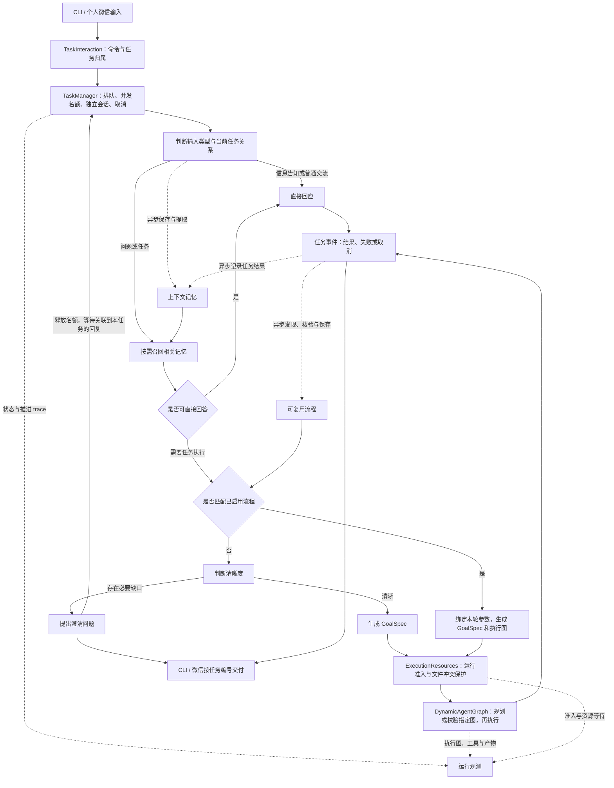
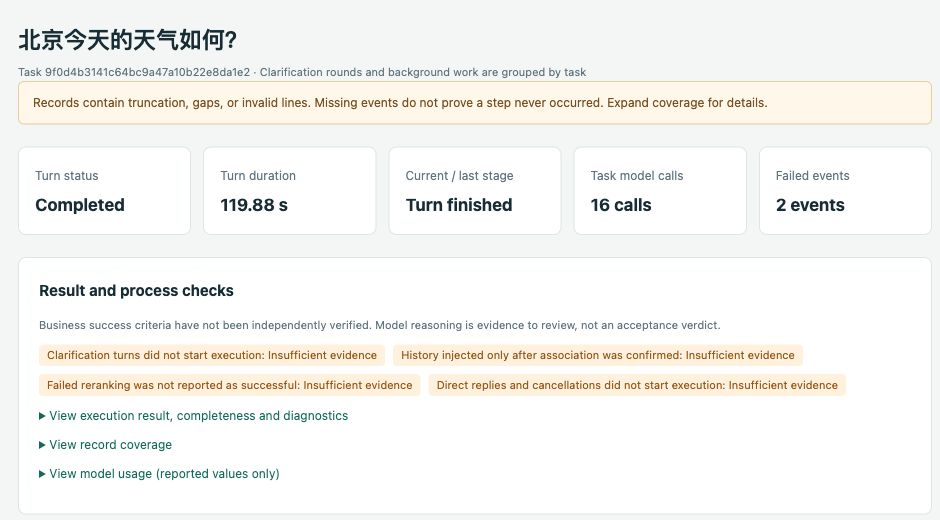
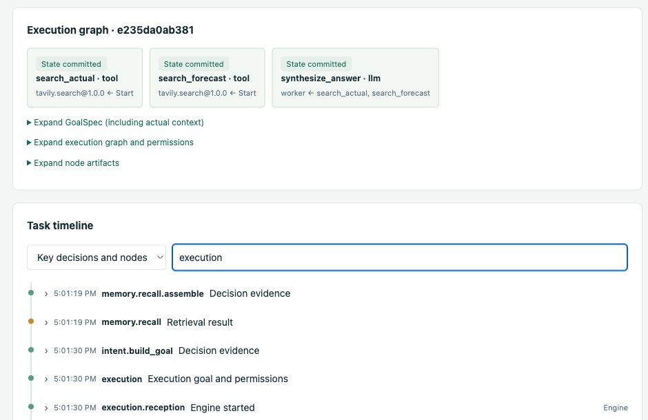

# Karen 详细指南

[English](GUIDE.md) | 简体中文

Karen 是一个面向个人的 Agent：理解用户想做什么，选取相关记忆，把请求转成有成功标准的目标，再调用工具完成任务。

我们希望它逐步成为了解用户、能够主动发现问题并推进工作的 Personal Agent。**当前版本已实现用户发起的多轮对话、上下文记忆、任务执行、定时任务、可复用流程和运行观测；主动发现任务与执行中等待用户确认尚未实现。**

## 为什么构建 Karen

日常使用 Agent 时，完成一次请求往往还需要用户承担许多衔接工作：反复描述背景、补充遗漏条件、提醒它不要混淆旧任务，并在失败后判断卡在哪一步。

Karen 希望减少这些负担，让请求从“说出来”到“得到结果”的过程连贯起来：

- **把需求说清楚。** 自然语言通常不完整，但不是每个未说明的偏好都需要追问。Karen 区分必要缺口与可采用合理默认值的信息，保留原始请求和澄清回答，逐轮形成可执行目标。
- **让有用背景持续生效。** 用户不必在每次交互中重新介绍自己的偏好和经历；新请求只召回相关背景，独立问题不自动附带最近的整段对话。
- **把目标交给执行流程。** 需要查询、操作或生成文件时，通过统一的目标契约进入任务引擎，记录实际执行、产物和失败原因。
- **让行为可以检查和改进。** 通过运行观测定位路由、澄清、记忆、规划与工具调用的问题，再用固定评测验证通用修复。

## 当前能做什么

| 能力 | 使用方式 |
| --- | --- |
| 多轮对话与输入路由 | 区分信息告知、普通交流、问题、任务请求及待澄清任务的补充或取消 |
| 并发任务管理 | CLI 与微信共享任务调度，独立会话、多轮回复归属、排队和取消；默认同时推进 2 项 |
| 定时任务 | CLI 与微信通过 `/schedule` 加自然语言新增、更新、删除、列出和手动触发任务；定时规则跨重启保存 |
| 必要澄清 | 信息不足时提出具体问题；合并回答后重新判断，直到目标明确 |
| 个人上下文记忆 | 自动提取和核验长期事实、偏好、事件摘要，支持跨重启召回及事实变更 |
| 查询与交付 | 搜索公开资料、读取网页、整理文字、生成 `/tmp` 下的文本或 HTML 文件，并请求本机浏览器打开 HTML |
| 可复用流程 | 在后台从新完成的任务中发现参数化流程；匹配请求复用经校验的执行图，跳过完整意图提取与规划 |
| 运行观测 | 查看每轮决策、召回候选、模型调用、执行图、产物及失败或降级原因 |

例如，可以分别告诉 Karen“我喜欢历史和考古”“我喜欢运动，比如骑行”，之后询问“我有哪些爱好？”；也可以让它检索资料、整理说明并保存为 HTML。记忆写入在后台进行，新信息进入可召回状态可能有延迟。

目前支持命令行和个人微信两个交互入口。任务能否完成取决于已注册工具、可获得的数据和模型判断；已知的语义与执行问题见下方评测说明。

## Karen 如何工作

Karen 采用高内聚、低耦合的模块划分：输入理解、上下文记忆、任务管理、可复用流程和运行观测在 Karen 内独立组织；任务规划与执行由 [DynamicAgentGraph](https://github.com/DavidLiuXh/DynamicAgentGraph) 负责。



任务管理位于渠道与输入理解之间：`TaskInteraction` 明确消息归属，`TaskManager` 为各任务保留独立会话、控制并发并交付事件。澄清等待释放名额；用户通过任务编号补充后恢复同一会话。执行资源模块负责运行准入和文件占用，实际工具调用时按路径申请租约，持续到执行图结束。独立图可以并行，复用流程与新规划的图遵循相同保护规则。记忆和流程发现的后台写入不占用前台任务推进名额。

### 从输入到可执行目标

输入模块使用 LangGraph 表达回应、澄清与目标构建流程。告知个人信息不需要启动任务规划；能依据本轮输入或相关记忆回答的问题直接回应；需要外部信息、操作或交付物的请求进入任务执行分支。

澄清维护原始请求、待决问题及回答关联，部分回答不会丢掉其余问题。每轮重新判断清晰度，只追问影响目标、范围、交付物或验收的必要信息。用户时区和首次输入时间作为日期基准，“今天”“明天”等相对日期据此解析。

目标明确后生成 DynamicAgentGraph 的 `GoalSpec`，包含目标、成功标准、约束、输入和上下文。引擎据此规划执行图、调用已授权能力，并返回执行结果。执行状态和输出结构通过校验，不等于所有业务成功标准已被独立验证。

### 多任务对话

CLI 和个人微信可以在已有任务运行时继续接收任务，默认同时推进 2 项；通过 `--max-concurrent-tasks N` 调整，也可与 `--wechat` 一起使用。每项任务拥有独立对话和任务编号，使用 `/new 内容`、`/tasks`、`/use ID`、`/reply ID 回答`、`/cancel ID` 管理。未关联的回答先保留，选择任务后再投递；第一版不猜测消息归属，后台回复携带任务编号。`/new`、`/reply` 及向已选任务成功提交输入后，焦点跟随实际接收的任务；澄清回复保留同一任务编号和会话。明确的任务归属也会约束模型路由，避免误判为新请求时清空待澄清会话。任务完成、失败或取消后，旧焦点不再接收普通输入；明确指定已完成任务可以创建后续任务，并选中新任务。

任务理解和独立执行图可以并发，已知文件操作通过运行级路径租约协调：冲突访问等待，不同路径可并行；尚未声明保护方式的工具保留整次运行串行。原覆盖规则不变，复用路径不保证保留旧内容；等待用户回复会释放任务名额。执行会话和任务队列保存在内存中，暂不提供通用重启恢复或自动重放；定时触发规则单独持久保存，见下节。微信原有交付重试和最近一次单会话澄清检查点保留。`--json` 现在输出包含 `notice`、`task` 事件的 JSON Lines。命令、退出与恢复边界见[任务管理说明](TASK_MANAGER.md)。

### 定时任务

CLI 和微信都支持 `/schedule` 加自然语言管理定时任务，也提供无需模型解析的列表、按编号触发和删除命令：

```text
/schedule 每天中午12点生成当天GitHub趋势的精美HTML页面
/schedule 把GitHub趋势任务改到每天下午一点
/schedule 每2个小时整理最新科技新闻
/schedule list
/schedule run 定时任务编号
/schedule delete 定时任务编号
/schedule 删除“GitHub趋势”
```

创建与更新后显示保存的执行内容、明确的时间规则、时区和下次触发时间；用 `/schedule list` 查看实际生成的名称、定时任务编号、最近执行状态及执行任务编号。自然语言目标使用完整编号或完整名称；同名时要求指定编号。规则或目标不明确时提示补充，需重新发送完整的 `/schedule` 操作。仅新增规则不会立即执行任务。

创建回复中名称前的编号（例如 `[95b5ec78] GitHub趋势精美页面`）是**定时任务编号**，代表保存的规则。每次自动或手动触发会另建一个**执行任务编号**，代表那一次执行。用定时任务编号管理规则，用执行任务编号回复澄清或取消当次执行：

```text
/schedule run 95b5ec78
/schedule 把95b5ec78改成每天早上10点执行
/schedule delete 95b5ec78
/reply 执行任务编号 补充信息
/cancel 执行任务编号
```

支持单次、每天、每周和固定间隔（最短一分钟、最长 366 天）。默认使用 `--timezone` 指定的时区，未指定时使用本机时区；可在命令中明确其他时区。“每两小时”从创建或修改间隔的时间开始计时，首次在两小时后；手动触发不改变原定时间。每天与每周按当地钟点计算；夏令时跳过不存在的钟点，重复钟点只取第一次。

每次触发创建独立任务，使用实际执行的时间基准解释“今天”“当天”等相对日期，复用现有并发名额、工具权限、记忆、流程和结果交付。同一定时任务上一轮仍在排队、执行或等待澄清时，跳过本次周期并在列表记录；手动触发此时会被拒绝。需要补充信息时使用执行任务编号通过 `/reply ID 回答` 继续。执行失败或队列满时记录状态，不自动重试；后续周期照常计算。删除规则不取消已经开始的执行，修改规则也不改写正在执行的任务；取消当前执行仍用 `/cancel 执行任务编号`。

**只有 Karen 进程运行时才会触发，不安装后台服务。** 定时规则保存在 CLI 的 `~/.Karne/schedules/cli/` 或当前微信账号的 `~/.Karne/weixin/<账号目录>/schedules/`，两个渠道分别管理。重启后跳过错过的周期；错过的单次规则不补跑，列表会显示无下次触发。中断的执行不自动恢复或重做。CLI 的 EOF 和退出会停止定时触发。

结果回到创建规则的渠道，携带定时任务与执行任务编号；CLI `--json` 的定时任务事件增加 `schedule_id`。微信每次触发建立独立收件记录，使用当前账号最新收到消息的回复上下文交付，发送重试不会重做任务；能否送达仍取决于微信回复上下文是否有效，可按既有 `/retry` 流程重试。定时管理只保存执行要求，不增加工具能力，Gmail 只读工具需单独配置，持续新邮件监测尚未实现。

### 可复用流程

命令行与微信渠道默认启用流程发现和复用，无需额外参数。例如，先让 Karen 获取当天 GitHub Trending，生成 HTML 保存到 `/tmp/github.html`，再用本地浏览器打开。对应流程经核验并启用后，后续请求相同交付时可以复用步骤，使用本轮日期和新的保存路径。可在观测面板查看状态：来源任务完成不代表模板一定已启用。

新任务完成后，Karen 在后台判断记录的执行图是否值得复用，提取参数、检查结构边界，并根据执行证据核验成功标准。证据充分的模板自动启用；证据不足或参数化不安全时只保存候选，不自动执行。启动时会有界地安排旧版已保存候选的重审，不扫描任意运行历史。重审结果发布为新的不可变版本，旧证据继续保留。

对于匹配的任务请求，Karen 保留输入路由与相关记忆召回，将本轮参数绑定到已启用模板。缺少参数时进入独立的补参循环；请求不匹配时走正常意图识别与规划。命中后生成新的 `GoalSpec`，通过 DynamicAgentGraph 的 `run_graph` 执行，跳过 planner 调用，同时保留授权、图校验、预算与取消机制。执行节点中的模型调用仍会发生，不继承旧日期、记忆或授权。指令中嵌入的变化值可通过精确声明的文本槽位提升为结构化运行输入；路径等字符串也可按声明的位置组合。未覆盖或重叠的槽位仍会阻断启用。固定行为属于适用条件，不会伪装成可切换参数。

流程定义与 SQLite/FTS5 索引保存在 `~/.Karne/workflows/`。正常退出等待后台持久化，强制退出可能丢失队列中的工作。复用结果也会在后台核验；有失败证据或用户明确否定刚才的流程结果时，可暂停模板。用户对刚才来源结果的明确认可，可以为其实际确认的 unknown 标准补充证据，并关联到该任务及用户原始输入。“谢谢”、无关赞美或已失败的标准不能据此启用模板；其他无法确认的验收仍标记 unknown。失败或部分执行的流程不自动从头重放。

开启 `--observe` 后，**可复用流程**面板展示模板、后台作业，以及发现、提取、核验、保存和来源任务的关联记录，支持中英文，并展示重审、反馈事件与模板版本历史（旧版保留为 superseded）。匹配总预算为 15 秒，不可用时回到正常理解路径。后台发现、核验与反馈判断会增加模型调用。需要配套 DynamicAgentGraph 版本包含 `run_graph` 和公共 `GraphSpec` 导出；更新两个仓库后执行 `uv sync`。

Karen 默认执行策略将单节点上限设为 180 秒，执行器整次运行上限仍为 600 秒，由规划、工具、模型节点和重试共同使用。节点最多使用剩余执行预算，已注册工具可以有更短上限；调用方显式传入的策略保持不变。输入理解与记忆召回另有阶段预算，因此 600 秒是执行上限，不是整轮交互的端到端期限。

### 三层记忆与选择性召回

| 层级 | 内容 | 作用 |
| --- | --- | --- |
| m1 | 有来源并经模型核验的长期事实与偏好 | 回答当前个人信息、提供持续有效的背景 |
| m2 | 对话和任务的事实、行动、状态及交付物摘要 | 初步检索历史事件，定位相关任务与证据 |
| m3 | 按用户当地日期轮转的 JSONL 详细记录及附件 | 根据摘要来源或明确范围补查原文细节 |

记忆保留来源角色、时间、状态及版本关系。“计划搬到上海”与“目前住在北京”可以同时存在；已经发生的变更、纠正和未解决的冲突分别处理，避免只按记录时间简单覆盖。

写入、提取、核验和向量化异步进行；回答问题或执行任务前的召回则等待最终结果：

**向量检索 + BM25 → RRF 融合 → 补齐版本关系 → 限制精排输入 → LLM 精排 → 按需补查 m3。**

精排失败时沿用融合顺序，并明确记录降级。跨任务历史按关联性选择；同一次澄清的对话由当前会话直接保留。模型调用遵循通用接口，默认使用 DeepSeek；向量默认由本机 Ollama 的 BGE-M3 生成，SQLite 和 FTS5 保存索引与记录。

按时间范围查询交流历史时，直接枚举已持久化的普通对话和任务结果，按请求归并避免重复计数；明确的任务统计仍只计执行结果。原文短预览为回答提供独立于语义 Top-K 的依据，展示不全或来源不可用时保留标记。精排输入上限为 48 KiB，精排 90 秒、召回总计 180 秒的时间预算保持不变。

### 查看运行过程

用 `--observe` 随 Karen 一起启动本地只读页面，可以检查“为什么追问”“为什么召回这条记忆”“工具为什么失败”。普通回复呈现用户需要的结果；记忆 ID、完整模型请求和诊断等内部数据保留在观测记录中。普通回复不附加内部执行提示；任务失败或结果不完整时的错误原因、需要用户操作的提示仍会显示。`--json` 保留完整诊断字段。

观测页面支持中文和英文切换。以下截图来自一次真实的天气查询，仅截取任务详情区域；用户输入与记录中的证据保留原始语言。

**运行概览。** 查看完成状态、耗时、模型调用次数、失败事件与流程检查。截图保留记录覆盖范围的警告：任务完成并不代表所有观测记录都完整。



**执行图与时间线。** 两个搜索节点并行获取信息，再交给回答生成节点汇总。可搜索的时间线将记忆召回、目标构建与引擎执行关联到同一任务。



## 评测表现

**截至 2026-10-07，最新代码尚未完成固定清单的完整复测。** 下表是最近一次完整复测的已保存结果，对应 Karen **`6a0f483`**，早于后续通用提示词整理、思考配置和截断恢复改动。

| 评测集 | 主要检查内容 | 通过 / 总数 | 通过率 |
| --- | --- | ---: | ---: |
| CLAMBER 固定子集 | 是否需要澄清、澄清问题是否解决实质缺口 | 14 / 24 | 58.3% |
| LongMemEval oracle 固定子集 | 跨重启记忆、事实更新、时间推理与信息不足 | 13 / 14 | 92.9% |
| Karen 中文回归 | 路由、多轮澄清、日期、偏好、住所变更及取消 | 11 / 12 | 91.7% |
| 独立变体回归 | 用不同表述与条件检查通用修复 | 12 / 12 | 100% |
| 边界回归 | 封闭条件、用途和偏好关系等边界 | 4 / 4 | 100% |
| **合计** | **同一固定清单** | **54 / 66** | **81.8%** |

同一清单上一轮为 47/66；另行新增的八条澄清回归本轮为 8/8，不并入上述分母。完整失败清单和比较依据见 [完整复测报告](EVALUATION_FULL_ACCEPTANCE_20261007.md)。

后续改动的验证单独记录，不与旧成绩拼接：

| 后续验证 | 结果 | 说明 |
| --- | --- | --- |
| 通用提示词整理后的新增迁移回归 | 10 / 12 | 另有 1 条判定失败、1 条模型服务错误；属于开发回归，非盲测 |
| 思考配置与截断恢复后的真实集成抽查 | 3 / 3 | 覆盖爱好、当前住所和相对日期；截断恢复由模拟 HTTP 响应验证 |

这些是**固定小样本结果，不是公开数据集全集或官方榜单成绩**。LongMemEval 使用 oracle 证据历史和自定义 DeepSeek 评分，没有完成 S/M 长干扰历史评测；CLAMBER 测试到回应、澄清或 GoalSpec，不代表外部任务已执行成功。运行错误和评分错误均计入分母，已见用例的重复成功不覆盖此前失败。

当前仍需改进的主要问题包括：必要信息与可选偏好的区分不够稳定，部分条件和指代存在误判，英文目标语言不一致，以及复杂任务的规划、输出预算和执行时限问题。部分公开标签与评分也存在分歧，原判定继续保留。后续修复已有局部验证，但尚不能据此声称整组达标率提高。

详细依据：[评测协议与复现](EVALUATION.md)、[提示词整理验证](PROMPT_POLICY_VERIFICATION_20261007.md)、[配置与截断恢复验证](MODEL_BUDGET_VERIFICATION_20261007.md)。

## 安装

### 1. 准备环境与源码

需要 Git、Python 3.11 或 3.12、[uv](https://docs.astral.sh/uv/getting-started/installation/)、[Ollama](https://ollama.com/download)，以及 DeepSeek API 密钥。网络搜索另需 Tavily API 密钥。

当前采用本地源码安装，需有两个仓库的访问权限，并将它们放在相邻目录中：

```bash
mkdir -p ~/opensource
cd ~/opensource
git clone https://github.com/DavidLiuXh/DynamicAgentGraph.git
git clone https://github.com/DavidLiuXh/Karen.git
cd Karen
uv sync --python 3.12
```

已有源码时直接进入 Karen 目录运行 `uv sync`。`pyproject.toml` 将执行库指向 `../DynamicAgentGraph`；安装不修改执行库源码。

### 2. 准备本地向量模型

启动 Ollama 服务；已经运行时跳过此步骤：

```bash
ollama serve
```

在另一个终端下载模型，已安装时无需重复下载：

```bash
ollama pull bge-m3:latest
```

Ollama 用于 embedding，默认 LLM 仍为云端 DeepSeek。Ollama 暂不可用时，已有记录可降级使用 BM25；向量处理失败会被记录。

### 3. 配置密钥

在 Karen 根目录创建 `.env`，填入自己的密钥：

```dotenv
DEEPSEEK_API_KEY=your_deepseek_api_key
TAVILY_API_KEY=your_tavily_api_key
```

`DEEPSEEK_API_KEY` 必需；不使用网络搜索时可省略 `TAVILY_API_KEY`。`.env` 已被 Git 忽略。
启动时使用 `uv run --env-file .env ...` 显式加载，也可以在 shell 中导出对应环境变量。

## 使用

### 启动并查看运行过程

在 Karen 目录运行：

```bash
uv run --env-file .env karen --observe
```

浏览器访问启动时打印的地址，默认是 `http://127.0.0.1:8765/`。页面每两秒刷新，服务随 Karen 退出关闭。端口被占用时可用 `--observe 8766`；不需要页面时省略 `--observe`，运行记录仍会保存。

| 参数 | 用途 |
| --- | --- |
| `--observe [PORT]` | 同时启动观测页面，默认端口 8765 |
| `--timezone Asia/Shanghai` | 显式指定用户的 IANA 时区；默认读取本机时区 |
| `--json` | 展示完整结果 JSON，便于调试 |
| `--wechat` | 使用个人微信交互，首次启动扫码绑定 |
| `--wechat-login` | 仅绑定或刷新微信凭据，不启动模型 |
| `--help` | 查看命令说明 |

远程运行时应显式提供用户时区。日常显示直接回复或执行结果的 `answer`；用户要求的来源和影响结论的重要限制写入回答，不自动附加内部审计字段。类似 `1）……；2）……` 的行内连续编号会分段显示。

交互式终端会将回答和澄清问题渲染为 Markdown，支持列表、表格和代码高亮，并按终端宽度换行。重定向和管道保留原始文本；`--json` 保留原始 JSON。渲染不改变已保存的回答或微信消息。基础终端（`TERM=dumb`）使用纯文本；不渲染图片和 HTML。

交互终端默认优先使用 PATH 中的可选工具 `glow`。用 `--no-glow` 可切换到 Rich。未安装 Glow 或渲染失败时也会回退到 Rich。包含列表的回复使用 Rich，编号和项目符号有强调色，折行对齐条目正文。设置 `NO_COLOR` 时，Rich 保留缩进并省去编号颜色。终端把日期和时间连在一起显示，例如 `2026-11-13T10:09`。

Rich 突出回答中已有的结论、依据、风险和限制标签。多段回答的结论在较宽的终端中使用边框，简短回复和窄终端使用行内标签。

### 通过个人微信使用

```bash
uv run karen --wechat-login
uv run --env-file .env karen --wechat --timezone Asia/Shanghai --observe
```

用本人的微信扫描二维码并在手机上确认。Karen 只接受绑定者的私聊，支持文字交互、
跨重启继续澄清、文件收发及投递重试。观测页面包含微信渠道事件。
限制、恢复规则和真实账号验收步骤见[个人微信接入说明](WEIXIN_cn.md)。

### 输入请求

下面是可以尝试的输入，分别覆盖个人信息、记忆查询、资料整理和文件交付：

```text
我喜欢历史和考古，也喜欢骑行。
我有哪些爱好？
帮我整理最近一个月北京的路亚水域信息，文字说明即可。
把刚才整理的内容保存为 /tmp/beijing-lure.html，并用本机浏览器打开。
```

需要澄清时使用 `/reply ID 回答`，或先用 `/use ID` 选中任务再回答；Karen 只合并该任务的要求并重新判断。有问题等待回答时，使用 `/new 内容` 发起无关任务，其他任务仍可推进。

输入 `/exit`、EOF 或 Ctrl+C 退出。EOF 等待已接收的推进完成；`/exit` 和 Ctrl+C 取消未完成任务。正常退出等待记忆持久化，记忆后台作业沿用既有恢复机制。任务调度本身仍在内存中，重启后不恢复；微信仅保留原有的最近一次单会话澄清检查点。强制终止可能丢失尚未落盘的信息。

### 当前工具范围

CLI 默认注册并授权当前可用能力；Tavily 未配置时仅搜索工具不可用。

| 工具 | 用途与边界 |
| --- | --- |
| `tavily.search` | 搜索公开网络资料，需要 `TAVILY_API_KEY` |
| `web.read_page` | 读取当前 HTTP/HTTPS 网页的精简正文，保留来源链接并标记截断 |
| `git.clone` | 使用本机 Git 将公开 HTTPS 仓库浅克隆到 `/tmp` 下的新目录，父目录须已存在 |
| `file.create_directory` | 在 `/tmp` 下创建目录及缺失的父目录，后续文件写入须依赖建目录节点 |
| `file.read_text` / `file.write_text` | 读取 `/tmp` 下最多 24,000 字节或写入最多 1 MiB 的 UTF-8 文本；覆盖须显式指定 |
| `file.read_text_range` | 分段读取 `/tmp` 下的 UTF-8 文本，每段最多 24,000 字节，并返回下一段偏移 |
| `browser.open_local_page` | 请求默认浏览器打开 `/tmp` 下已有的 HTML；打开请求成功不等于渲染成功 |

自定义接入可传入 `ExecutionPolicy` 限定能力白名单，模型不能自行扩大权限。当前没有执行中暂停并等待用户确认的流程。

### 本地数据与历史查看

记忆全局有效，同一记忆目录同时只允许一个写入进程。目录名沿用当前实现的 **`.Karne`**：

```text
~/.Karne/
  context/          # m1/m2、向量和全文索引、m3 原文及附件
  observability/    # 决策、模型调用和后台处理追踪
  runs/             # DynamicAgentGraph 执行图、节点记录和产物
  weixin/           # 私有凭据、持久化收件箱/发件箱、文件快照
```

记忆与运行记录保存在本地；模型提取、判断、精排和回答会将所需输入发送到配置的 LLM 服务，网络搜索调用 Tavily。观测日志与用户记忆分开保存。

Karen 退出后，仍可单独运行以下命令查看历史记录：

```bash
uv run karen-observe --open
```

## 开发与进一步阅读

核心入口是 `Karen.advance(session, text)`：直接回应读取 `TaskTurn.response`，真实执行读取 `TaskTurn.result`，两者都没有时读取 `session.questions`；下一轮传回 `turn.session`。调用方可以独立使用 `IntentRecognizer`，或注入自己的执行引擎、记忆与模型客户端。

| 文档 | 内容 |
| --- | --- |
| [输入路由](INPUT_ROUTING.md) | 输入分类、直接回应、会话关联及取消边界 |
| [多轮澄清](CLARIFICATION_STATE.md) | 待决问题台账、状态转换与目标构建 |
| [上下文记忆设计](CONTEXT_MEMORY_DESIGN.md) / [接口与运行](CONTEXT_MEMORY_IMPLEMENTATION.md) | m1/m2/m3、版本时间线、异步写入与同步召回 |
| [可复用流程](REUSABLE_WORKFLOWS.md) / [设计](REUSABLE_WORKFLOWS_DESIGN.md) | 后台发现、参数绑定、指定图执行与观测 |
| [运行观测](OBSERVABILITY.md) | 追踪、诊断、读取范围与服务生命周期 |
| [提示词维护](PROMPT_POLICY.md) | 通用规则与 few-shot 的组织原则 |
| [模型配置与预算](MODEL_BUDGET_VERIFICATION_20261007.md) | 思考强度、阶段时限及截断后的有界恢复 |
| [评测协议](EVALUATION.md) / [完整评测报告](EVALUATION_FULL_ACCEPTANCE_20261007.md) | 固定输入、判定标准、复现与逐例结果 |

当前默认模型为 `deepseek-flash`：输入理解、回应、执行节点和精排请求 low 思考，规划请求 medium；记忆提取、核验和查询理解使用非思考。具体客户端见 [模型装配](../src/karen/model/models.py)，阶段组合见 [CLI 入口](../src/karen/cli.py)；共享指令位于 [prompt/prompts.py](../src/karen/prompt/prompts.py)，模块专属提示词仍位于各模块的 `prompts.py`。

终端、微信、执行结果及观测入口的用户文案统一放在 [messages.py](../src/karen/message/messages.py)。模型指令、schema 字段说明及修复引导归入所属模块的 `prompts.py`；微信交付指令位于 [instructions.py](../src/karen/channels/weixin/instructions.py)。调整对应的命名模板，通过具名占位符传入数据。协议字段、状态/错误码、SQL 和测试数据仍由相应逻辑维护；观测页面现有的中英文字典保留在 `dashboard.html`。

离线行为与边界检查：

```bash
uv run pytest
uv run ruff check .
```

离线检查使用可控响应，不消耗模型 API 额度。真实模型评测单独按评测协议运行，使用隔离目录，不读取用户全局记忆；模型服务和实时检索会产生费用及结果波动。修复保持通用，不为单个评测题增加专用分支或修改标签来提高分数。

### Gmail 只读工具

启动 Karen 前，配置已有 `gmail.readonly` OAuth 授权的 `GMAIL_CLIENT_ID`、
`GMAIL_CLIENT_SECRET` 和 `GMAIL_REFRESH_TOKEN`。CLI 和微信会注册邮箱资料、收件箱分页、
邮件详情及历史变更四个只读工具。配置变更后需重启；授权流程与持续新邮件监测尚未实现。
接口和隐私边界见 [Gmail 访问](GMAIL.md)。

### 网页正文读取

Karen 使用 `web.read_page` 获取精简正文。依赖原始 `web.fetch` 的已保存流程会跳过，本轮请求走正常规划。详见[网页正文提取](WEB.md)。

大本地文件通过 `file.read_text_range` 按需分段读取。收集的研究证据可以在模型上下文窗口内一并交给汇总节点。
